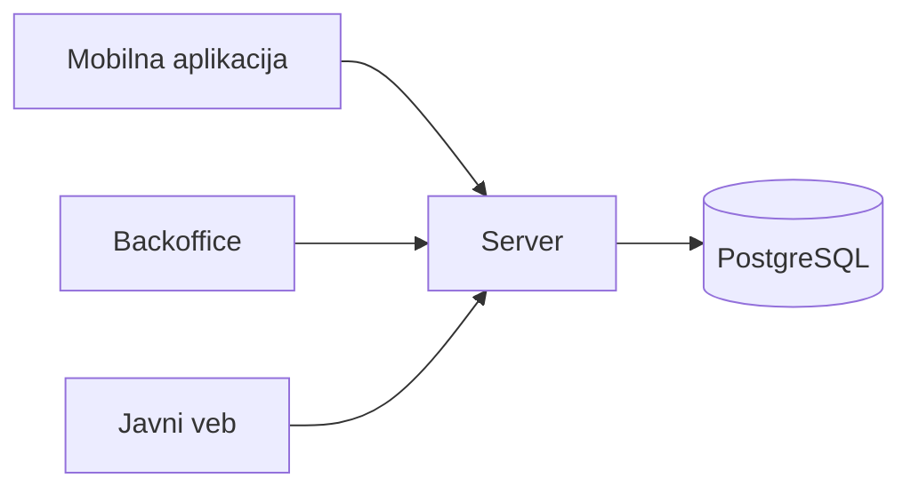

# SoundConnect

Projekat iz predmeta Razvoj multiplatformskih aplikacija.

## Opis sistema

SoundConnect je platforma za saradnju u muzičkoj produkciji. Pružaoci usluga (producenti, audio inženjeri i vokalisti), verifikovani od strane moderatora, objavljuju ponude za miks, mastering, vokale ili beatove, a klijenti (umetnici i drugi producenti) šalju zahteve za saradnju i prate ih do isporuke. Moderatori iz backoffice aplikacije verifikuju profile i pregledaju sve zahteve. Katalog pružalaca usluga javno je dostupan na vebu.

Sistem se sastoji od četiri dela koja dele isti domenski kod napisan u Dartu: mobilne aplikacije za klijente i pružaoce usluga, backoffice aplikacije za moderatore, servera koji čuva podatke i sprovodi pravila i javnog veba koji prikazuje sadržaj dostupan pretraživačima.

## Tim

| Ime i prezime   | Broj indeksa | GitHub nalog                                     |
| --------------- | ------------ | ------------------------------------------------ |
| Sava Radošević  | 80/24 SI     | [@sv1xy](https://github.com/sv1xy)               |
| Kosta Baštić    | 138/24 SI    | [@Kosta-Bastic](https://github.com/Kosta-Bastic) |

## Zahtevi za temu

### Uloge

Sistem ima tri uloge sa različitim ovlašćenjima: klijent, pružalac usluga i moderator. Klijent pregleda katalog, šalje zahteve za saradnju i upravlja samo svojim zahtevima. Pružalac usluga objavljuje ponudu i prihvata, odbija ili isporučuje zahteve upućene njemu. Moderator je osoblje: verifikuje profile pružalaca i ima uvid u sve zahteve.

### Stanja

Glavni pojam sistema je zahtev za saradnju i on prolazi kroz najmanje četiri stanja: poslat (klijent je poslao zahtev), prihvaćen (pružalac je prihvatio zahtev), u izradi (pružalac radi na isporuci), isporučen (pružalac je isporučio rezultat) i završen (klijent je potvrdio isporuku). Zahtev može biti i odbijen (pružalac ga je odbio) ili otkazan (klijent ga je otkazao).

### Pravila

Klijent može da otkaže zahtev samo dok ga pružalac nije prihvatio. Zahtev ima najviše dve revizije, odnosno klijent može najviše dva puta da vrati isporučen zahtev na doradu. Pružalac ima ograničen broj slobodnih mesta (npr. tri), a zahtev zauzima mesto dok nije završen, odbijen ili otkazan. Ovo pravilo zavisi od zahteva drugih klijenata, pa o njemu konačno odlučuje server: kada dva klijenta istovremeno pošalju zahtev za poslednje slobodno mesto, server prihvata samo jedan. Pružalac se prikazuje u javnom katalogu tek kada ga moderator verifikuje.

### Rad bez mreže

Klijent može bez mreže da otkaže poslat zahtev. Izmena se čuva lokalno i sinhronizuje sa serverom kada se veza ponovo uspostavi, a server je odbija ako je pružalac u međuvremenu prihvatio zahtev.

### Posao za osoblje

Moderatori rade sa većim brojem zapisa, što zahteva veći ekran. Backoffice aplikacija na desktopu prikazuje tabelu svih zahteva i profila, sa filtriranjem i pretragom, i red čekanja za verifikaciju profila.

### Javni sadržaj

Deo podataka dostupan je svima, bez prijave, i ima smisla za pretraživače: javni katalog verifikovanih pružalaca usluga i stranice njihovih profila (žanrovi, usluge, cena od, slobodna mesta, linkovi ka primerima).

## Delovi sistema

| Deo                | Korisnici                     | Tehnologija       | Platforme    |
| ------------------ | ----------------------------- | ----------------- | ------------ |
| Mobilna aplikacija | klijenti, pružaoci usluga     | Flutter           | Android      |
| Backoffice         | moderatori                    | Flutter           | Windows, veb |
| Javni veb          | svi posetioci                 | Jaspr             | pregledač    |
| Server             | ostali delovi sistema         | Relic, PostgreSQL | Linux        |
| Domenski paket     | svi delovi sistema            | Dart              | sve          |

Svi delovi koriste isti domenski paket, u kome su model i pravila. Server čuva podatke i ponovo proverava svako pravilo.

## Stanje projekta

Opis sistema. Detaljan opis domena i kod dodaju se tokom semestra.
