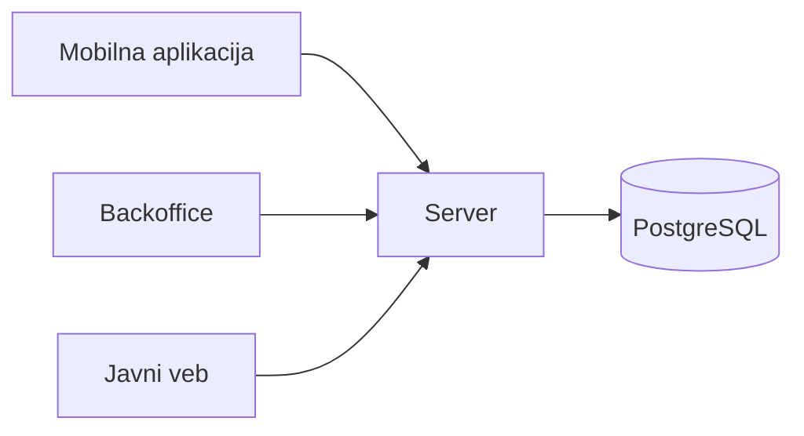

# SoundConnect

Projekat iz predmeta Razvoj multiplatformskih aplikacija.

## Tim

| Ime i prezime   | Broj indeksa | GitHub nalog                                     |
| --------------- | ------------ | ------------------------------------------------ |
| Sava Radošević  | 80/24 SI     | [@sv1xy](https://github.com/sv1xy)               |
| Kosta Baštić    | 138/24 SI    | [@Kosta-Bastic](https://github.com/Kosta-Bastic) |

## Opis sistema

SoundConnect je platforma za saradnju u muzičkoj produkciji. Pružaoci usluga (producenti, audio inženjeri i vokalisti), verifikovani od strane moderatora, objavljuju ponude za miks, mastering, vokale ili beatove, a klijenti (umetnici i drugi producenti) šalju zahteve za saradnju i prate ih do isporuke. Moderatori iz backoffice aplikacije verifikuju profile, pregledaju sve zahteve i rešavaju sporove oko isporuke. Katalog pružalaca usluga javno je dostupan na vebu.

Sistem se sastoji od četiri dela koja dele isti domenski kod napisan u Dartu: mobilne aplikacije za klijente i pružaoce usluga, backoffice aplikacije za moderatore, servera koji čuva podatke i sprovodi pravila i javnog veba koji prikazuje sadržaj dostupan pretraživačima.

## Zahtevi za temu

### Uloge

Sistem ima tri uloge sa različitim ovlašćenjima: klijent, pružalac usluga i moderator. Klijent pregleda katalog, šalje zahteve za saradnju i upravlja samo svojim zahtevima. Pružalac usluga objavljuje ponudu i prihvata, odbija ili isporučuje zahteve upućene njemu. Moderator je osoblje: verifikuje profile pružalaca, ima uvid u sve zahteve i može da menja njihovo stanje (otkazuje zahteve i rešava sporove oko isporuke).

### Stanja

Glavni pojam sistema je zahtev za saradnju i on prolazi kroz najmanje četiri stanja: poslat (klijent je poslao zahtev), prihvaćen (pružalac je prihvatio zahtev), u izradi (pružalac radi na isporuci), isporučen (pružalac je isporučio rezultat) i završen (klijent je potvrdio isporuku). Zahtev može biti i odbijen (pružalac ga je odbio) ili otkazan (klijent ili moderator su ga otkazali).

### Pravila

Klijent može da otkaže zahtev samo dok ga pružalac nije prihvatio. Zahtev ima najviše dve revizije, odnosno klijent može najviše dva puta da vrati isporučen zahtev na doradu. Pružalac ima ograničen broj slobodnih mesta (npr. tri), a zahtev zauzima mesto dok nije završen, odbijen ili otkazan. Ovo pravilo zavisi od zahteva drugih klijenata, pa o njemu konačno odlučuje server: kada dva klijenta istovremeno pošalju zahtev za poslednje slobodno mesto, server prihvata samo jedan. Pružalac se prikazuje u javnom katalogu tek kada ga moderator verifikuje.

Moderator može da otkaže svaki zahtev koji nije završen, odbijen ili otkazan, i da isporučen zahtev označi kao završen ili ga vrati u izradu. Završen, odbijen i otkazan zahtev ne mogu više da menjaju stanje.

### Rad bez mreže

Klijent može bez mreže da otkaže poslat zahtev. Izmena se čuva lokalno i sinhronizuje sa serverom kada se veza ponovo uspostavi, a server je odbija ako je pružalac u međuvremenu prihvatio zahtev.

### Posao za osoblje

Moderatori rade sa većim brojem zapisa, što zahteva veći ekran. Backoffice aplikacija na desktopu prikazuje tabelu svih zahteva i profila, sa filtriranjem i pretragom, i red čekanja za verifikaciju profila. Iz tabele moderator menja stanje zahteva: otkazuje zahtev, zatvara isporučen zahtev kao završen ili ga vraća na doradu.

### Javni sadržaj

Deo podataka dostupan je svima, bez prijave, i ima smisla za pretraživače: javni katalog verifikovanih pružalaca usluga i stranice njihovih profila (žanrovi, usluge, cena od, slobodna mesta, linkovi ka primerima).

## Delovi sistema

| Deo                | Korisnici                     | Tehnologija       | Platforme    |
| ------------------ | ----------------------------- | ----------------- | ------------ |
| Mobilna aplikacija | klijenti, pružaoci usluga     | Flutter           | Android      |
| Backoffice         | moderatori                    | Flutter           | Windows, veb |
| Javni veb          | svi posetioci                 | Jaspr             | pregledač    |
| Server             | ostali delovi sistema         | Relic, PostgreSQL | Linux        |
| Domenski paket     | svi delovi sistema            | Dart              | sve          |

Svi delovi koriste isti domenski paket, u kome su model i pravila. Server čuva podatke i ponovo proverava svako pravilo.



## Stanje projekta

KT1: mobilna aplikacija i backoffice rade nad istim domenskim paketom, nad lažnim podacima u memoriji. Svaki klijent ima svoje podatke i oni nisu sinhronizovani. Server, javni veb i rad bez mreže dolaze u KT2–KT4.

| Folder | Šta je |
| --- | --- |
| `packages/domain` | čist Dart: model, stanja zahteva (`RequestStatus`), `canTransition`, pravila (`rules.dart`), akcije i portovi |
| `packages/blocs` | čist Dart: `RequestsBloc` (glavni tok klijenta), `CatalogBloc`, `NewRequestBloc`, `AdminRequestsBloc` |
| `packages/ui` | tema, font Inter, srpski nazivi i poruke grešaka, zajednički widget-i |
| `apps/mobile` | Flutter za Android, uloga klijent |
| `apps/backoffice` | Flutter za Windows i veb, uloga moderator |

Pravila (zahtev 3) su u `packages/domain/lib/src/rules.dart`, a konstante (`maxRevisions`, `maxNoteLength`, `defaultCapacity`) na vrhu tog fajla.

### Pokretanje

Potrebni su Flutter 3.47 (Dart 3.13), Android SDK sa emulatorom ili telefonom za mobilnu aplikaciju i Visual Studio sa „Desktop development with C++“ za Windows verziju backoffice-a. Okruženje se proverava komandom `flutter doctor`.

Iz korena repozitorijuma:

```sh
flutter pub get
```

Mobilna aplikacija, na Android emulatoru ili telefonu:

```sh
cd apps/mobile
flutter run
```

Backoffice:

```sh
cd apps/backoffice
flutter run -d windows    # ili -d chrome
```

Testovi: `dart test` u `packages/domain` i `packages/blocs`, `flutter test` u `apps/mobile` i `apps/backoffice`.

### Demo stanja ekrana

- Mobilna: kartica **Podešavanja** ima prekidače „Sledeći zahtev vraća grešku“ i „Sledeća lista zahteva je prazna“.
- Backoffice: meni sa ikonicom epruvete u gornjem desnom uglu.

### Backoffice tastaturom

| Prečica | Radnja |
| --- | --- |
| ↑ ↓ | kretanje kroz zahteve |
| Enter | otvori detalj |
| Esc | zatvori detalj |
| Ctrl F | pretraga |
| Ctrl K | otkaži izabrani zahtev |
| Ctrl Enter | zatvori isporučen zahtev kao završen |
| Ctrl Shift Enter | vrati isporučen zahtev u izradu |
| F1 ili ? | pregled prečica |

Ispod 720 px širine tabela postaje lista, a izbor ostaje.