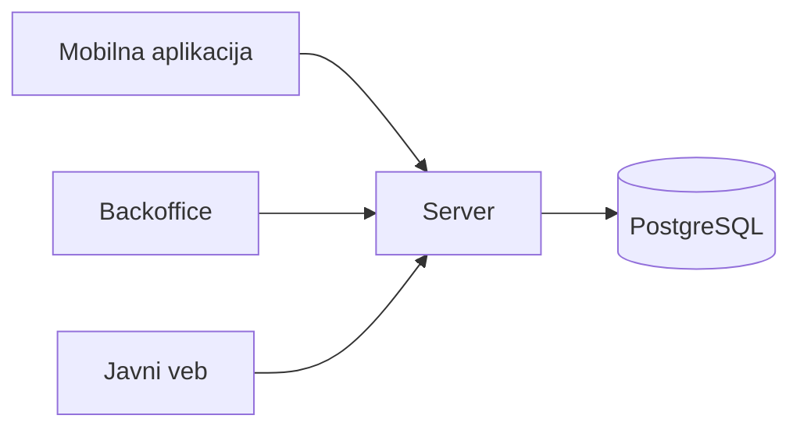

# SoundConnect

Platforma za saradnju u muzičkoj produkciji. Pružaoci usluga (producenti, audio inženjeri i vokalisti), verifikovani od strane moderatora, objavljuju ponude za miks, mastering, vokale ili beatove, a klijenti (umetnici i drugi producenti) šalju zahteve za saradnju i prate ih do isporuke. Moderatori iz backoffice aplikacije verifikuju profile i pregledaju sve zahteve. Katalog pružalaca usluga javno je dostupan na vebu.

Projekat iz predmeta Razvoj multiplatformskih aplikacija.

## Tim

| Ime i prezime   | Broj indeksa | GitHub nalog                                     |
| --------------- | ------------ | ------------------------------------------------ |
| Sava Radošević  | 80/24 SI     | [@sv1xy](https://github.com/sv1xy)               |
| Kosta Baštić    | 138/24 SI    | [@Kosta-Bastic](https://github.com/Kosta-Bastic) |

## Zahtevi za temu

1. **Uloge.** Sistem koriste klijenti, pružaoci usluga i moderatori, sa različitim ovlašćenjima. Klijent upravlja samo svojim zahtevima, pružalac obrađuje zahteve upućene njemu, a moderator vidi sve profile i zahteve i verifikuje pružaoce.
2. **Stanja.** Zahtev za saradnju prolazi kroz stanja: poslat, prihvaćen, u izradi, isporučen i završen, a može biti i odbijen ili otkazan.
3. **Pravila.** Klijent može da otkaže zahtev samo dok ga pružalac nije prihvatio, a zahtev ima najviše dve revizije. Pružalac ima ograničen broj slobodnih mesta (npr. tri), a zahtev zauzima mesto dok nije završen, odbijen ili otkazan. To zavisi od zahteva drugih klijenata, pa o tome odlučuje server, na primer kada dva klijenta istovremeno pošalju zahtev za poslednje slobodno mesto.
4. **Rad bez mreže.** Klijent može bez signala da otkaže poslat zahtev. Izmena se šalje kada se veza vrati, a server je odbija ako je pružalac u međuvremenu prihvatio zahtev.
5. **Posao za osoblje.** Moderatori rade sa tabelom svih zahteva i redom čekanja za verifikaciju profila, što je posao za veći ekran.
6. **Javni sadržaj.** Katalog verifikovanih pružalaca usluga i stranice njihovih profila (žanrovi, usluge, cena od, slobodna mesta, linkovi ka primerima) dostupni su svima bez prijave i imaju smisla za pretraživače.

## Delovi sistema

| Deo                | Korisnici                     | Tehnologija       | Platforme    |
| ------------------ | ----------------------------- | ----------------- | ------------ |
| Mobilna aplikacija | klijenti, pružaoci usluga     | Flutter           | Android      |
| Backoffice         | moderatori                    | Flutter           | Windows, veb |
| Javni veb          | svi posetioci                 | Jaspr             | pregledač    |
| Server             | ostali delovi sistema         | Relic, PostgreSQL | Linux        |
| Domenski paket     | svi delovi sistema            | Dart              | sve          |

Svi delovi koriste isti domenski paket, u kome su model i pravila. Server čuva podatke i ponovo proverava svako pravilo.

## Stanje projekta

Opis sistema. Detaljan opis domena i kod dodaju se tokom semestra.
