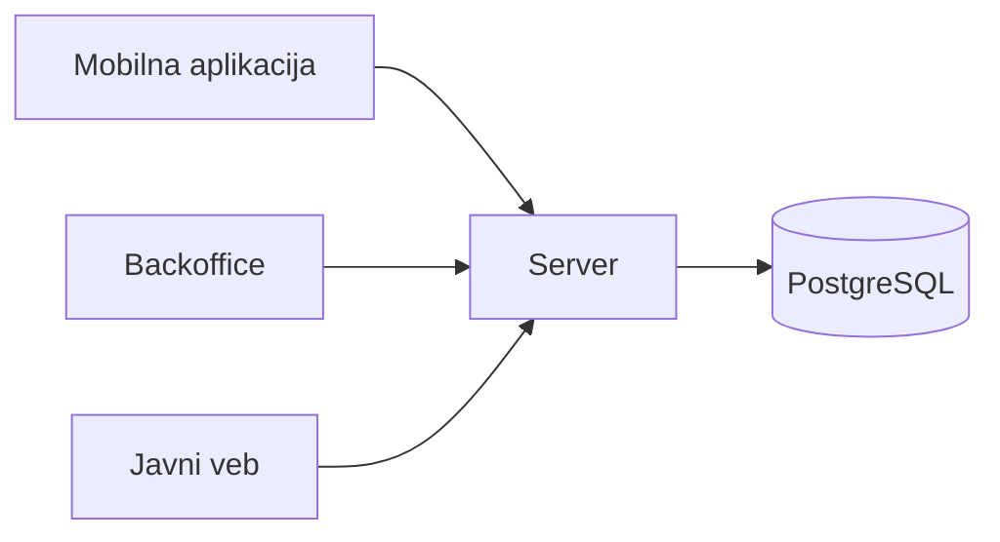

# SoundConnect

Projekat iz predmeta Razvoj multiplatformskih aplikacija.

## Tim

| Ime i prezime   | Broj indeksa | GitHub nalog                                     |
| --------------- | ------------ | ------------------------------------------------ |
| Sava Radošević  | 80/24 SI     | [@sv1xy](https://github.com/sv1xy)               |
| Kosta Baštić    | 138/24 SI    | [@Kosta-Bastic](https://github.com/Kosta-Bastic) |

## Opis sistema

SoundConnect je platforma za saradnju u muzičkoj produkciji. Pružaoci usluga (producenti, audio inženjeri i vokalisti), verifikovani od strane moderatora, objavljuju ponude za miks, mastering, vokale ili beatove, a klijenti (umetnici i drugi producenti) šalju zahteve za saradnju i prate ih do isporuke. Moderatori iz backoffice aplikacije verifikuju profile, pregledaju sve zahteve i rešavaju sporove oko isporuke. Katalog pružalaca usluga javno je dostupan na vebu.

Sistem se sastoji od četiri dela koja dele isti domenski kod napisan u Dartu: mobilne aplikacije za klijente i pružaoce usluga, backoffice aplikacije za moderatore, servera koji čuva podatke i sprovodi pravila i javnog veba koji prikazuje sadržaj dostupan pretraživačima.

## Zahtevi za temu

### Uloge

Sistem ima tri uloge sa različitim ovlašćenjima: klijent, pružalac usluga i moderator. Klijent pregleda katalog, šalje zahteve za saradnju i upravlja samo svojim zahtevima. Pružalac usluga objavljuje ponudu i prihvata, odbija ili isporučuje zahteve upućene njemu. Moderator je osoblje: verifikuje profile pružalaca, ima uvid u sve zahteve i može da menja njihovo stanje (otkazuje zahteve i rešava sporove oko isporuke).

### Stanja

Glavni pojam sistema je zahtev za saradnju i on prolazi kroz najmanje četiri stanja: poslat (klijent je poslao zahtev), prihvaćen (pružalac je prihvatio zahtev), u izradi (pružalac radi na isporuci), isporučen (pružalac je isporučio rezultat) i završen (klijent je potvrdio isporuku). Zahtev može biti i odbijen (pružalac ga je odbio) ili otkazan (klijent ili moderator su ga otkazali).

### Pravila

Klijent može da otkaže zahtev samo dok ga pružalac nije prihvatio. Zahtev ima najviše dve revizije, odnosno klijent može najviše dva puta da vrati isporučen zahtev na doradu. Pružalac ima ograničen broj slobodnih mesta (npr. tri), a zahtev zauzima mesto dok nije završen, odbijen ili otkazan. Ovo pravilo zavisi od zahteva drugih klijenata, pa o njemu konačno odlučuje server: kada dva klijenta istovremeno pošalju zahtev za poslednje slobodno mesto, server prihvata samo jedan. Pružalac se prikazuje u javnom katalogu tek kada ga moderator verifikuje.

Moderator može da otkaže svaki zahtev koji nije završen, odbijen ili otkazan, i da isporučen zahtev označi kao završen ili ga vrati u izradu. Završen, odbijen i otkazan zahtev ne mogu više da menjaju stanje.

### Rad bez mreže

Klijent može bez mreže da otkaže poslat zahtev. Izmena se čuva lokalno i sinhronizuje sa serverom kada se veza ponovo uspostavi, a server je odbija ako je pružalac u međuvremenu prihvatio zahtev.

### Posao za osoblje

Moderatori rade sa većim brojem zapisa, što zahteva veći ekran. Backoffice aplikacija na desktopu prikazuje tabelu svih zahteva i profila, sa filtriranjem i pretragom, i red čekanja za verifikaciju profila. Iz tabele moderator menja stanje zahteva: otkazuje zahtev, zatvara isporučen zahtev kao završen ili ga vraća na doradu.

### Javni sadržaj

Deo podataka dostupan je svima, bez prijave, i ima smisla za pretraživače: javni katalog verifikovanih pružalaca usluga i stranice njihovih profila (žanrovi, usluge, cena od, slobodna mesta, linkovi ka primerima).

## Delovi sistema

| Deo                | Korisnici                     | Tehnologija       | Platforme    |
| ------------------ | ----------------------------- | ----------------- | ------------ |
| Mobilna aplikacija | klijenti, pružaoci usluga     | Flutter           | Android      |
| Backoffice         | moderatori                    | Flutter           | Windows, veb |
| Javni veb          | svi posetioci                 | Jaspr             | pregledač    |
| Server             | ostali delovi sistema         | Relic, PostgreSQL | Linux        |
| Domenski paket     | svi delovi sistema            | Dart              | sve          |

Svi delovi koriste isti domenski paket, u kome su model i pravila. Server čuva podatke i ponovo proverava svako pravilo.



## Stanje projekta

KT2: server i baza su izvor istine za oba klijenta. Mobilna aplikacija i backoffice rade nad serverom, sa prijavom i ulogama; isti domenski paket proverava pravila na telefonu, na desktopu, u pregledaču i na serveru. Javni veb i rad bez mreže dolaze u KT3–KT4.

| Folder | Šta je |
| --- | --- |
| `packages/domain` | čist Dart: model, stanja (`RequestStatus`), `canTransition`, pravila (`rules.dart`), prava (`access_policy.dart`), akcije i portovi |
| `packages/api_contract` | ugovor klijenata i servera: putanje, DTO-i, kodovi grešaka, `problem+json`; bez domena, Flutter-a i `dart:io` |
| `packages/api_mapping` | jedino mesto prevoda domen ↔ ugovor, u oba smera i za greške |
| `packages/api_client` | HTTP implementacija portova, ista za mobilnu i backoffice, na VM-u i u pregledaču |
| `packages/blocs` | čist Dart: `SessionBloc`, `LoginFormBloc`, `RequestsBloc`, `CatalogBloc`, `NewRequestBloc`, `AdminRequestsBloc` |
| `packages/ui` | tema, font Inter, srpski nazivi i poruke grešaka, forma za prijavu, zajednički widget-i |
| `apps/server` | Relic 1.2.0 i PostgreSQL; dbmate migracije, početni podaci, prijava (JWT, Argon2id) |
| `apps/mobile` | Flutter za Android, uloge klijent i pružalac |
| `apps/backoffice` | Flutter za Windows i veb, uloga moderator |

Pravila su u `packages/domain/lib/src/rules.dart` (konstante `maxRevisions`, `maxNoteLength`, `defaultCapacity` na vrhu), a prava (ko sme u koju aplikaciju, koji zapis vidi, koju akciju pokreće) u `packages/domain/lib/src/access_policy.dart`.

### Pokretanje iz čistog klona

Potrebni su Docker Desktop, Flutter 3.47 (Dart 3.13), Android SDK sa emulatorom za mobilnu aplikaciju i Visual Studio sa „Desktop development with C++“ za Windows verziju backoffice-a. Na Windows-u Flutter traži uključen **Developer Mode** (`start ms-settings:developers`) jer aplikacije koriste plugin za bezbedno skladište.

1. Baza, šema, početni podaci i server, jednom komandom iz korena:

   ```sh
   copy .env.example .env      # Linux/macOS: cp .env.example .env
   docker compose up -d
   ```

   Server je na `http://localhost:8080` (`/health` vraća `ok`). Početni podaci se upisuju pri prvom podizanju.

2. Zavisnosti za Flutter, iz korena:

   ```sh
   flutter pub get
   ```

3. Mobilna aplikacija, na Android emulatoru (server nalazi kao `10.0.2.2:8080`, bez izmene koda):

   ```sh
   cd apps/mobile
   flutter run
   ```

4. Backoffice na Windows-u i u pregledaču (port 8081 je u `CORS_ORIGINS`):

   ```sh
   cd apps/backoffice
   flutter run -d windows
   flutter run -d chrome --web-port 8081
   ```

Drugi server: `--dart-define=SERVER_URL=http://adresa:8080`. Bez servera, nad lažnim podacima u memoriji: `--dart-define=LAZNI_PODACI=true` (lozinka demo naloga je tada `demo`).

### Demo nalozi

Lozinka svih naloga je `DEMO_PASSWORD` iz `.env` (u `.env.example`: `soundconnect-demo`); u bazi je samo Argon2id heš.

| Nalog | Korisnik | Uloga | Aplikacija |
| --- | --- | --- | --- |
| `klijent1` | Sava Radošević | klijent | mobilna |
| `klijent2` | Mila Jovanović | klijent | mobilna |
| `pruzalac1` | Marko „Mix“ Petrović | pružalac | mobilna |
| `moderator1` | Kosta Baštić | moderator | backoffice |

Korisnik mobilne aplikacije u backoffice-u (i moderator u mobilnoj) dobija poruku zašto ne može da uđe.

### Portovi i alati

| Šta | Adresa |
| --- | --- |
| Server | `http://localhost:8080` |
| PostgreSQL | `localhost:5435` |
| Backoffice u pregledaču | `http://localhost:8081` |
| Adminer (pregled baze) | `http://localhost:8082`, posle `docker compose --profile tools up -d` |

- Poziv mimo aplikacije (pravila, prava, trka za poslednje mesto): `powershell -ExecutionPolicy Bypass -File apps\server\tool\demo.ps1`.
- Vraćanje početnih podataka: `docker compose down -v`, pa `docker compose up -d`.
- Istek prijave za proveru: `SESSION_TTL_MINUTES=1` u `.env`, pa `docker compose up -d server`.
- Server nedostupan: `docker compose stop server`; oba klijenta kažu da server nije dostupan.

### Testovi

Iz korena `flutter analyze`, a testovi iz foldera svakog dela:

| Folder | Komanda |
| --- | --- |
| `packages/domain`, `blocs`, `api_contract`, `api_mapping`, `api_client` | `dart test` (VM i pregledač) |
| `apps/server` | `dart test` (traži bazu: `docker compose up -d db`) |
| `apps/mobile`, `apps/backoffice` | `flutter test` |

Testovi servera rade nad posebnim bazama `soundconnect_test_*` u istom kontejneru, sa istim migracijama.

### Odluke

| Pitanje | Izbor | Odbačeno |
| --- | --- | --- |
| Pravilo koje zavisi od drugih | ograničen broj: pružalac ima najviše `capacity` aktivnih zahteva | preklapanje u vremenu (tema nema termine) |
| Ko ga konačno čuva | server, u transakciji: red pružaoca `FOR UPDATE`, pa pravilo iz domena, pa upis | ograničenje u bazi (pravilo bi postojalo dvaput); brava u memoriji (ne radi sa više servera) |
| Šta vidi zakasneli | 409 `no-free-slots` sa granicom; ista poruka kao na klijentu, pa ponovo učitan katalog | lista čekanja ili tiho ponavljanje |
| Šta koja uloga vidi | klijent svoje zahteve, pružalac upućene njemu i imena tih klijenata, moderator sve | klijent vidi tuđe zahteve kod pružaoca |
| Novac, vreme, stanja na mreži | ceo broj evra, ISO 8601 u UTC, stanja kao tekst (`in-progress`) | `double`, lokalno vreme, brojevi za stanja |
| Deo velike liste | `limit`/`offset` sa ukupnim brojem; backoffice po 50, „Učitaj još“ | sve odjednom; kursor |
| Tuđa promena | posle osvežavanja ekrana i posle odbijene akcije | WebSocket, periodično prozivanje |
| Pregledač | HttpOnly kolačić umesto tokena, CORS samo za `CORS_ORIGINS` | token u `localStorage` (dostupan skriptama) |
| Bez prijave | samo katalog (u KT4 ide na javni veb) | ceo API iza prijave |
| Ko menja tuđi zapis | moderator: otkazuje nezavršen, zatvara i vraća u izradu isporučen; pružalac: prihvata i odbija upućen njemu | klijent menja tuđi zahtev |
| Spoljni servis | obaveštenje pružaocu o novom zahtevu, iza `NotificationPort` na serveru; ključ samo u `.env` servera, za KT2 lažna implementacija | poziv servisa iz aplikacije (ključ bi bio na uređaju) |

### Demo stanja ekrana

Nad lažnim podacima (`LAZNI_PODACI=true`): u mobilnoj kartica **Podešavanja** ima prekidače „Sledeći zahtev vraća grešku“, „Sledeća lista zahteva je prazna“ i „Prijava ističe sada“; u backoffice-u je meni sa ikonicom epruvete. Nad serverom se greška veze pokazuje zaustavljanjem servera.

### Backoffice tastaturom

| Prečica | Radnja |
| --- | --- |
| ↑ ↓ | kretanje kroz zahteve |
| Enter | otvori detalj |
| Esc | zatvori detalj |
| Ctrl F | pretraga |
| Ctrl K | otkaži izabrani zahtev |
| Ctrl Enter | zatvori isporučen zahtev kao završen |
| Ctrl Shift Enter | vrati isporučen zahtev u izradu |
| F1 ili ? | pregled prečica |

Ispod 720 px širine tabela postaje lista, a izbor ostaje.